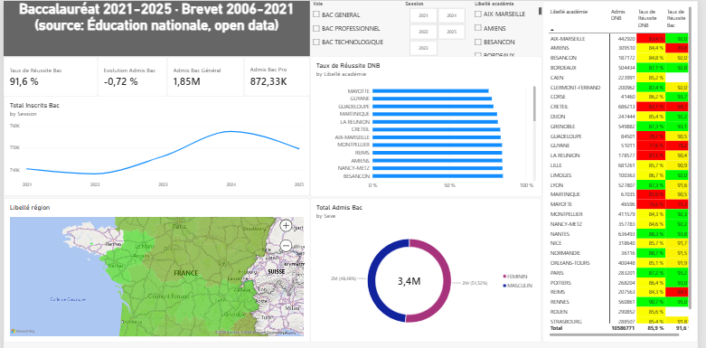

# Tableau de bord Power BI — Éducation nationale

Tableau de bord Power BI interactif sur les résultats du baccalauréat (2021-2025) et du brevet (2006-2021). Conçu pour démontrer ce que je sais construire sous Power BI, sur un jeu de données lisible par tous les profils, data comme risque. Un projet Power BI orienté risque est prévu à la suite.

## Méthodes
- Power Query — nettoyage, typage, traitement des valeurs manquantes, dimension Académies construite par ajout de requêtes (Append) et dédoublonnage
- Modèle de données — schéma en étoile : deux tables de faits (Baccalauréat, DNB) reliées à une dimension Académies, relations plusieurs-à-un
- DAX — 12 mesures (SUM, DIVIDE, CALCULATE), dont taux de réussite et évolution annuelle
- Visuels — deux graphiques avec drill-down (région → académie → département → commune ; sexe → série), carte choroplèthe, matrice avec mise en forme conditionnelle rouge/jaune/vert, segments et cartes KPI

## Outils
Power BI Desktop · Power Query · DAX

## Compétences
Power Query · modélisation en étoile · DAX (CALCULATE, DIVIDE) · drill-down · mise en forme conditionnelle · cartes et segments

## Données
Éducation nationale, open data (data.education.gouv.fr) : fr-en-baccalaureat-par-academie, fr-en-dnb-par-etablissement. Les fichiers sources ne sont pas inclus : le `.pbix` contient les données importées.

## Utilisation
Ouvrir le fichier `.pbix` dans Power BI Desktop.

## Contexte
Réalisé en parallèle du Master Analyse des Politiques Économiques Publiques (APEP) — Option Économétrie et Data Science Appliquées, FSJES Aïn Chock, Université Hassan II de Casablanca.